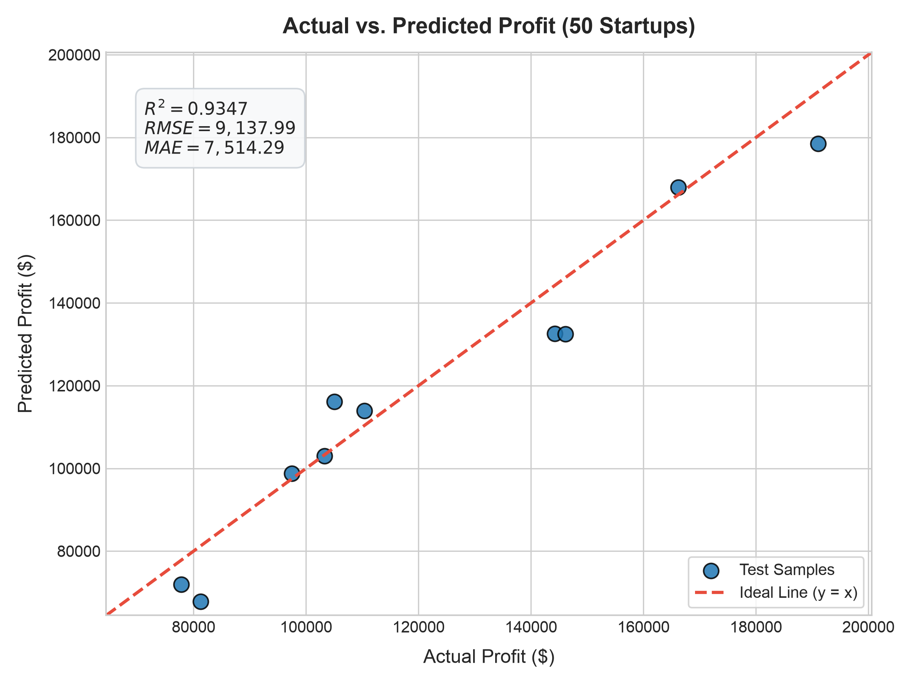

# 50 Startups: Multiple Linear Regression & Forward Selection (CRISP-DM)

A comprehensive Machine Learning project predicting startup profitability (`Profit`) using Multiple Linear Regression and Forward Selection under the **CRISP-DM** (Cross-Industry Standard Process for Data Mining) framework.

---

## Table of Contents
- [Executive Summary](#executive-summary)
- [Project Architecture & Directory Structure](#project-architecture--directory-structure)
- [CRISP-DM Methodology](#crisp-dm-methodology)
  - [Phase 1: Business Understanding](#phase-1-business-understanding)
  - [Phase 2: Data Understanding](#phase-2-data-understanding)
  - [Phase 3: Data Preparation](#phase-3-data-preparation)
  - [Phase 4: Modeling](#phase-4-modeling)
  - [Phase 5: Evaluation](#phase-5-evaluation)
  - [Phase 6: Deployment](#phase-6-deployment)
- [Forward Selection Deep-Dive](#forward-selection-deep-dive)
- [Key Business Insights & Conclusions](#key-business-insights--conclusions)
- [Environment Setup & How to Run](#environment-setup--how-to-run)

---

## Executive Summary

This study analyzes financial and operational expenditures across 50 startups to identify the primary drivers of profit and construct parsimonious linear regression models. 

### Key Findings
1. **R&D Spend is the Dominant Factor**: R&D investment accounts for over 94.6% of startup profit variation ($R^2 = 0.9465$, coefficient $\approx 0.7735$).
2. **Optimal Feature Subset ($k = 2$)**: Forward selection with 5-fold cross-validation on the training set identified that combining **`R&D Spend`** and **`Marketing Spend`** achieves the best out-of-sample performance (**Test $R^2 = 0.9474$**, **Test RMSE = $8,198.80**), outperforming the full 5-feature model (**Test $R^2 = 0.9347$**, **Test RMSE = $9,137.99**).
3. **Diminishing Returns of Geographic Location & Administration**: State dummy variables and administrative expenses do not add predictive value and slightly increase model variance, highlighting the risk of overfitting.

---

## Project Architecture & Directory Structure

```text
startup_regression/
├── .venv/                               # Python isolated virtual environment
├── outputs/                             # Output artifacts generated by script
│   ├── actual_vs_predicted_profit.png   # Scatter plot of actual vs predicted profit
│   └── forward_selection_results.csv    # Empirical results across k=1..5 features
├── requirements.txt                     # Pinned project dependencies
├── startup_regression.py                # Complete end-to-end CRISP-DM pipeline
└── README.md                            # Comprehensive CRISP-DM technical report
```

### File Manifest
- **`startup_regression.py`**: Automated end-to-end pipeline implementing all six CRISP-DM stages: data download, exploratory data analysis, one-hot encoding, train/test split, multiple linear regression, performance evaluation, forward selection via 5-fold CV, and artifact generation.
- **`requirements.txt`**: Specifies all required Python packages (`pandas`, `numpy`, `requests`, `scikit-learn`, `matplotlib`, `tabulate`).
- **`outputs/actual_vs_predicted_profit.png`**: High-resolution scatter plot visualizing actual vs. predicted startup profits with an ideal reference line ($y = x$) and key metrics annotations.
- **`outputs/forward_selection_results.csv`**: Tabulated experimental results containing Training 5-Fold CV RMSE, Test RMSE, and Test $R^2$ for subsets of 1 to 5 features.

---

## CRISP-DM Methodology

### Phase 1: Business Understanding

#### 1. Background & Objective
Startups operate in high-risk, capital-constrained environments where capital allocation determines business survival. The objective of this project is to model and predict the target variable `Profit` using operational expenditures (`R&D Spend`, `Administration`, `Marketing Spend`) and geographical headquarters location (`State`).

#### 2. Stakeholder Value
- **Venture Capitalists & Angel Investors**: Assess startup valuations, estimate projected profitability, and benchmark spending efficiency before making investment decisions.
- **Startup Founders & C-Suite Executives**: Guide budget planning and resource allocation to optimize return on investment (ROI) while minimizing cash burn rate.
- **Incubators & Accelerators**: Provide evidence-based spending guidelines for early-stage portfolio companies.

---

### Phase 2: Data Understanding

The dataset was downloaded programmatically via HTTP `GET` using Python's `requests` library from:
`https://raw.githubusercontent.com/harimittapalli/Mulitple-Linear-Reggression/master/50_Startups.csv`

#### 1. Dataset Shape & Integrity
- **Total Records**: 50 rows
- **Total Columns**: 5 columns
- **Missing Values**: 0 across all features and target variable

#### 2. Feature Schema & Summary Statistics
| Feature | Data Type | Mean | Std Dev | Min | Median (50%) | Max | Description |
|---|---|---|---|---|---|---|---|
| **R&D Spend** | Continuous (`float64`) | $73,721.62 | $45,902.26 | $0.00 | $73,051.08 | $165,349.20 | Research & Development expenditure |
| **Administration** | Continuous (`float64`) | $121,344.64 | $28,017.77 | $51,283.14 | $122,699.80 | $182,645.56 | Management & operational expenses |
| **Marketing Spend** | Continuous (`float64`) | $211,025.10 | $122,290.31 | $0.00 | $212,716.24 | $471,784.10 | Marketing, advertising & promotion |
| **State** | Categorical (`str`) | 3 unique values: `New York`, `California`, `Florida` | Headquarters jurisdiction |
| **Profit** *(Target)* | Continuous (`float64`) | $112,012.64 | $40,306.18 | $14,681.40 | $107,978.19 | $192,261.83 | Operating profit generated |

---

### Phase 3: Data Preparation

#### 1. Categorical Variable Encoding (Avoiding the Dummy Variable Trap)
The categorical column `State` contains three distinct classes: `California`, `Florida`, and `New York`. 
To avoid **multicollinearity** (the *Dummy Variable Trap*), we apply One-Hot Encoding with `drop_first=True` using `pandas.get_dummies()`:
- `California` acts as the reference (baseline) category when both dummy variables equal `0`.
- `State_Florida` = 1 if the startup is based in Florida, 0 otherwise.
- `State_New York` = 1 if the startup is based in New York, 0 otherwise.

This reduces the state dimensions to 2 independent features, preventing a singular design matrix $(X^TX)^{-1}$.

#### 2. Train-Test Split
To guarantee sound statistical evaluation and avoid data leakage:
- **Test Size**: 20% (10 samples)
- **Train Size**: 80% (40 samples)
- **Random State**: 0 (`random_state=0`) for complete reproducibility

---

### Phase 4: Modeling

We train a Multiple Linear Regression model using `sklearn.linear_model.LinearRegression` on all 5 features:

$$\hat{y} = \beta_0 + \beta_1 X_{\text{R\&D}} + \beta_2 X_{\text{Admin}} + \beta_3 X_{\text{Marketing}} + \beta_4 D_{\text{Florida}} + \beta_5 D_{\text{New York}}$$

#### Empirical Regression Results (Full Feature Model)
- **Intercept ($\beta_0$)**: `$42,554.17`

| Feature | Coefficient ($\beta_j$) | Interpretation |
|---|---|---|
| **R&D Spend** | **+0.7735** | Each additional $1 spent on R&D is associated with an expected profit increase of ~$0.77. |
| **Administration** | **+0.0329** | Administration spending shows minimal direct leverage on profitability (~$0.03 per $1 spent). |
| **Marketing Spend** | **+0.0366** | Marketing spending has a minor positive correlation (~$0.037 per $1 spent). |
| **State_Florida** | **-959.28** | Being based in Florida relative to California is associated with a ~$959 lower profit, ceteris paribus. |
| **State_New York** | **+699.37** | Being based in New York relative to California is associated with a ~$699 higher profit, ceteris paribus. |

---

### Phase 5: Evaluation

#### 1. Evaluation Metrics on Unseen Test Set (10 Samples)
- **R-squared ($R^2$)**: **`0.9347`** (93.47% of profit variance in test data explained)
- **Mean Absolute Error (MAE)**: **`$7,514.29`**
- **Mean Squared Error (MSE)**: **`83,502,864.03`**
- **Root Mean Squared Error (RMSE)**: **`$9,137.99`**

#### 2. Actual vs. Predicted Profit Visualization
The generated plot (`outputs/actual_vs_predicted_profit.png`) demonstrates high predictive alignment along the ideal $y = x$ reference line:



---

### Phase 6: Deployment

- **Automated Script Execution**: The entire pipeline runs via a single command:
  ```bash
  ./.venv/bin/python startup_regression.py
  ```
- **Self-contained Artifact Generation**: Outputs are systematically exported to `outputs/`:
  - `outputs/actual_vs_predicted_profit.png`: Visualization ready for investor presentations.
  - `outputs/forward_selection_results.csv`: Audit-ready metrics exportable to BI dashboards.

---

## Forward Selection Deep-Dive

### Algorithm Design
To avoid overfitting and select the most parsimonious model, forward stepwise selection was implemented under strict validation constraints:
1. **Selection Criterion**: 5-Fold Cross-Validation RMSE on the **Training Set Only** (`KFold(n_splits=5, shuffle=True, random_state=0)`).
2. **Information Leakage Prevention**: The **Test Set is NEVER accessed** during feature selection.
3. **Stepwise Iteration**: At each step $k \in \{1, 2, 3, 4, 5\}$, the candidate feature producing the minimum training CV RMSE is added.
4. **Out-of-Sample Evaluation**: Once $k$ features are selected, the model is retrained on the full 40-sample training set, and tested on the 10-sample test set to compute Test RMSE and Test $R^2$.

### Empirical Forward Selection Results
Below are the actual numbers obtained from execution:

| Step ($k$) | Added Feature | Selected Features | Train 5-Fold CV RMSE ($) | Test RMSE ($) | Test $R^2$ |
|:---:|---|---|:---:|:---:|:---:|
| **1** | **R&D Spend** | `R&D Spend` | 9,745.40 | 8,274.87 | 0.9465 |
| **2** | **Marketing Spend** | `R&D Spend, Marketing Spend` | **9,482.34** | **8,198.80** | **0.9474** |
| **3** | Administration | `R&D Spend, Marketing Spend, Administration` | 9,678.08 | 8,803.78 | 0.9394 |
| **4** | State_Florida | `R&D Spend, Marketing Spend, Administration, State_Florida` | 9,885.56 | 9,068.54 | 0.9357 |
| **5** | State_New York | `R&D Spend, Marketing Spend, Administration, State_Florida, State_New York` | 10,158.66 | 9,137.99 | 0.9347 |

### Analysis of Results
1. **Optimal Model is $k = 2$**:
   - Both the Training 5-Fold CV RMSE ($9,482.34) and the Test RMSE ($8,198.80) reach their lowest values at **$k = 2$** (`R&D Spend` + `Marketing Spend`).
   - The test set $R^2$ reaches its maximum of **`0.9474`**.
2. **Occam's Razor & Overfitting**:
   - Adding `Administration`, `State_Florida`, and `State_New York` (Steps 3, 4, 5) steadily *increases* both the cross-validation error (from $9,482.34 up to $10,158.66) and test error (from $8,198.80 up to $9,137.99).
   - This proves that extraneous features introduce variance without contributing explanatory power.

---

## Key Business Insights & Conclusions

1. **Prioritize R&D Above All**:
   - R&D expenditure is the single most predictive indicator of startup profitability. Startups focusing heavily on core technology and product innovation exhibit higher operating margins.
2. **Complement with Targeted Marketing**:
   - Combining R&D with Marketing produces the optimal predictive model ($R^2 = 0.9474$), indicating that strong product development paired with go-to-market execution drives peak financial return.
3. **Minimize Administrative Bloat**:
   - High administrative spending does not correlate with increased profit; lean organizational structures preserve capital for revenue-generating activities.
4. **Geography is Secondary**:
   - Modern startups operate across state borders. Location differences between California, New York, and Florida account for negligible profit differences compared to core product-market fit.

### Threats to Validity & Limitations
1. **Sample Size Constraint**: The dataset contains 50 records ($N = 50$), with 10 records in the test set. While standard for academic demonstration, larger multi-year datasets across diverse industries and market cycles are recommended before making real-world capital decisions.
2. **Correlation vs. Causality**: Regression coefficients demonstrate empirical association rather than direct causation. Increasing R&D budget without strategic alignment or market demand does not automatically guarantee profit.
3. **Omitted Variables**: Key startup success factors such as founder experience, team size, competitive landscape, and macroeconomic factors are unobserved in this dataset.

---

## Environment Setup & How to Run

### Prerequisites
- Python 3.10+ (tested on Python 3.11.4)
- Internet connection (to download dataset on execution)

### Quick Start

1. **Clone or Navigate to the Workspace**:
   ```bash
   cd /Users/pengjie/Documents/startup_regression
   ```

2. **Activate Virtual Environment**:
   ```bash
   source .venv/bin/activate
   ```
   *(If creating from scratch: `python3 -m venv .venv && source .venv/bin/activate && pip install -r requirements.txt`)*

3. **Run the Script**:
   ```bash
   python startup_regression.py
   ```

4. **Verify Generated Artifacts**:
   - Scatter plot: `outputs/actual_vs_predicted_profit.png`
   - Forward selection CSV: `outputs/forward_selection_results.csv`
